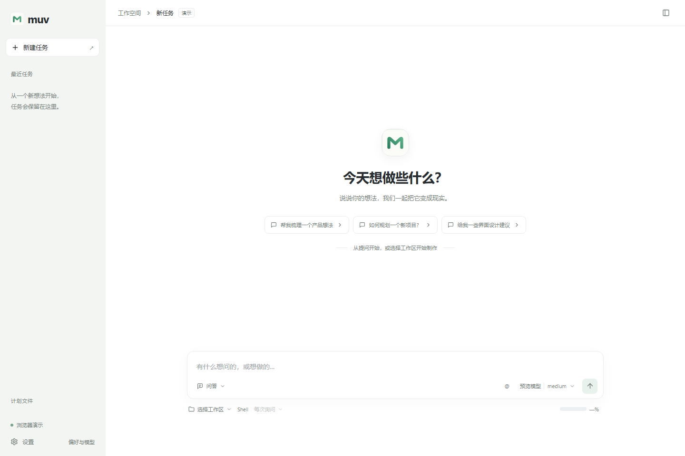
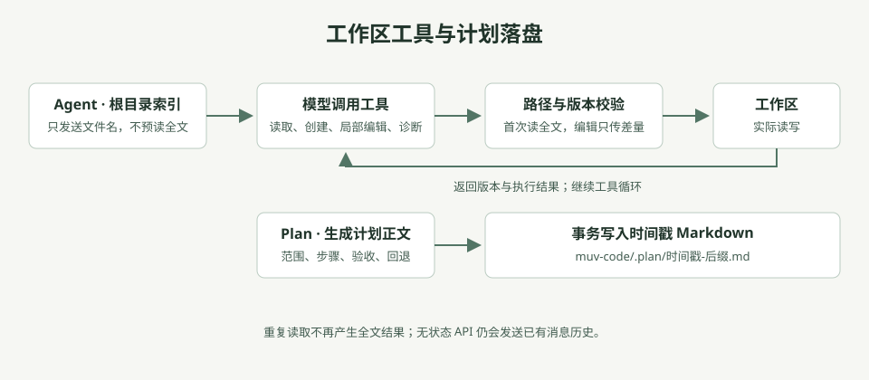
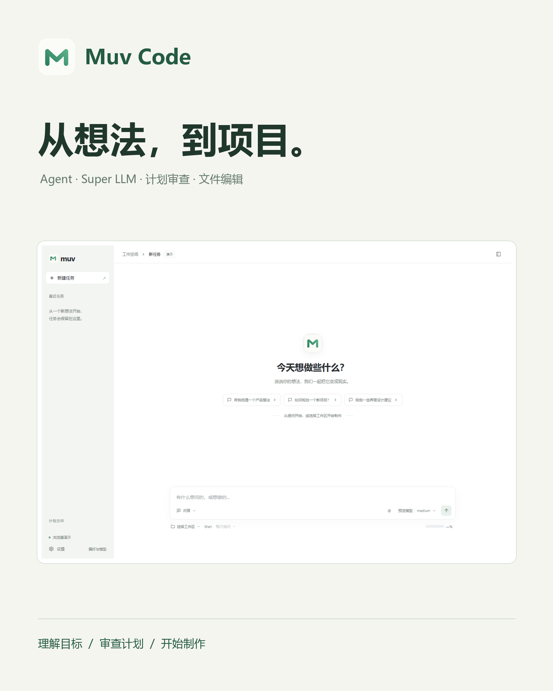

# Muv Code

用自然语言在本地工作区完成项目任务的 Windows AI 工作台。



## 快速开始

在仓库 Releases 下载 Windows x64 安装程序，安装后打开「设置 → 模型」，填写 OpenAI-compatible API 地址与 API Key，获取模型列表并保存。选择工作区，再发送任务。

| 模式 | 行为 |
| --- | --- |
| Ask | 问答与项目讨论 |
| Plan | 生成计划并按时间保存到工作区 `muv-code/.plan/` |
| Agent | 直接调用工作区工具执行任务 |
| Super LLM | 理解需求 → Spec → Plan → 最多两轮自审 → 保存 Markdown → 等待用户点击构建 |

计划可从侧栏打开，编辑、预览、保存后构建。`@` 可引用文件、文件夹列表和已有终端输出。子代理负责只读调查，由主代理接收结果后继续执行。

从源码运行需要 Node.js 22 或更新版本、npm，以及可用的 Electron 下载网络：

```sh
npm ci
npm run dev
```

浏览器演示：`npm run dev:web`。演示不具备本地工作区读写能力。

## 结构说明

技术栈为 Electron、React、TypeScript、Vite。

| 目录 | 内容 |
| --- | --- |
| `electron/` | 主进程、模型流、文件事务、子代理、Shell 授权与测试 |
| `ui/` | 对话、工具日志、diff、Todo、计划编辑和设置 |
| `build/` | 软件图标源文件及多尺寸资源 |
| `architecture/` | 工作区工具架构图 |
| `scripts/` | 图标生成脚本 |
| `marketing/` | 浏览器截图与宣传海报 |



## 规范要点

- 文件按需读取，局部编辑使用版本检查；重复读取不重复产生完整文件结果。无状态 API 仍会发送对话历史。
- 工具调用、正文与模型公开返回的思考内容按事件顺序展示；文件修改可查看 diff，运行期间可按顺序撤销，外部修改冲突会阻止覆盖。
- Shell 提供每次询问、自动审批、完全访问。自动审批仅放行固定诊断命令；完全访问需主动确认。工作目录不是沙箱，执行命令前请核对内容。
- API Key 由 Electron safeStorage 加密；启用的记忆、引用和项目内容可能发送给配置的模型服务。
- 上下文占用为估算值；实际用量与缓存命中仅在服务返回相应字段时显示。

```sh
npm test
npm run typecheck
npm run build
npm run build:win
```

Windows 打包使用 electron-builder NSIS。安装程序位于 `release/`，不纳入源码版本管理。

## 已知限制

- 安装包尚未代码签名，Windows 可能提示未知发布者。
- 模型服务需要支持 Chat Completions、流式响应及对应工具调用；各提供商能力存在差异。
- 多模态设置目前仅记录能力声明，输入仍为文本。
- 子代理只读且不支持嵌套委派；任务仍受取消、超时与数据大小边界约束。
- 撤销事务与终端引用不跨应用重启持久化。
- 完整远端模型与桌面端端到端验收尚未覆盖所有流程；不要将测试通过等同于任意模型均兼容。


